<div align="center">

# CaliCore

**Tu núcleo de la calistenia.** Un sitio web para aprender calistenia de verdad: un árbol ilustrado e interactivo con todas las progresiones, una biblioteca de ejercicios explicados paso a paso, su historia y un perfil para guardar lo que quieres dominar.


[Capturas](#-capturas) · [Recorrido por la página](#-recorrido-por-la-página) · [Instalación](#-instalación-local)

</div>

---

## 📑 Tabla de contenidos

- [¿Qué es?](#-qué-es)
- [Capturas](#-capturas)
- [Recorrido por la página](#-recorrido-por-la-página)
- [Funcionalidades](#-funcionalidades)
- [¿Cómo funciona?](#️-cómo-funciona)
- [Stack tecnológico](#️-stack-tecnológico)
- [Diseño visual](#-diseño-visual)
- [Arquitectura y modularidad](#-arquitectura-y-modularidad)
- [Estructura del proyecto](#️-estructura-del-proyecto)
- [Base de datos](#️-base-de-datos)
- [API](#-api)
- [Instalación local](#-instalación-local)
- [Pruebas](#-pruebas)
- [Seguridad](#-seguridad)
- [Aprendizajes](#-aprendizajes)
- [Mejoras futuras](#-mejoras-futuras)
- [Autor](#-autor)
- [Créditos y licencia](#-créditos-y-licencia)

---

## 📌 ¿Qué es?

CaliCore es un sitio informativo de calistenia, el entrenamiento con el propio peso del cuerpo. El nombre une **Cali**, de calistenia, con **Core**, el núcleo: la idea es reunir en un solo lugar todo lo que alguien necesita para entender por dónde empezar y hacia dónde avanzar.

El centro del sitio es un **árbol de progresiones**: 79 ejercicios ordenados en 17 caminos dentro de 5 ramas (Empuje, Tracción, Pierna, Core y Habilidades), más un tronco de fundamentos. Cada camino va del ejercicio más accesible al más exigente, y cada ejercicio tiene su ficha con la ejecución paso a paso, los errores más comunes, los músculos que trabaja y qué necesitas dominar antes.

## 📸 Capturas

| Inicio | El árbol |
|:---:|:---:|
| 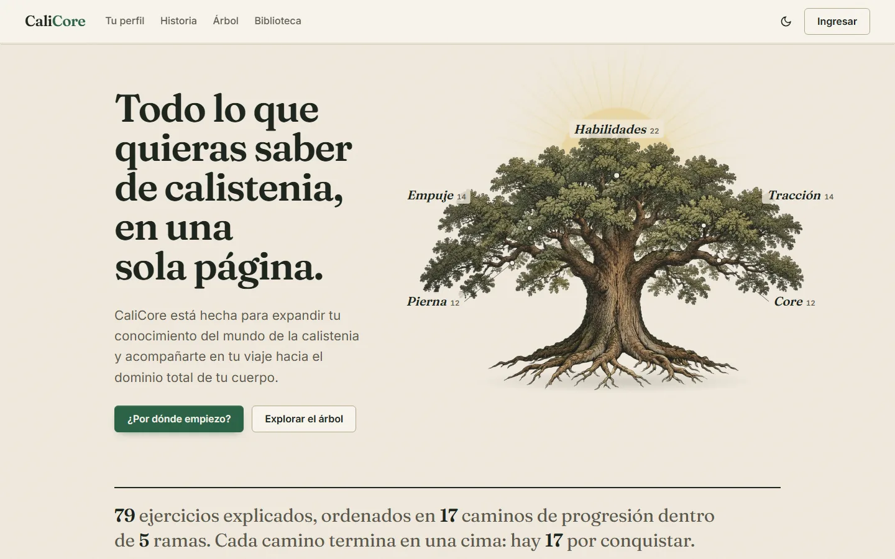 | 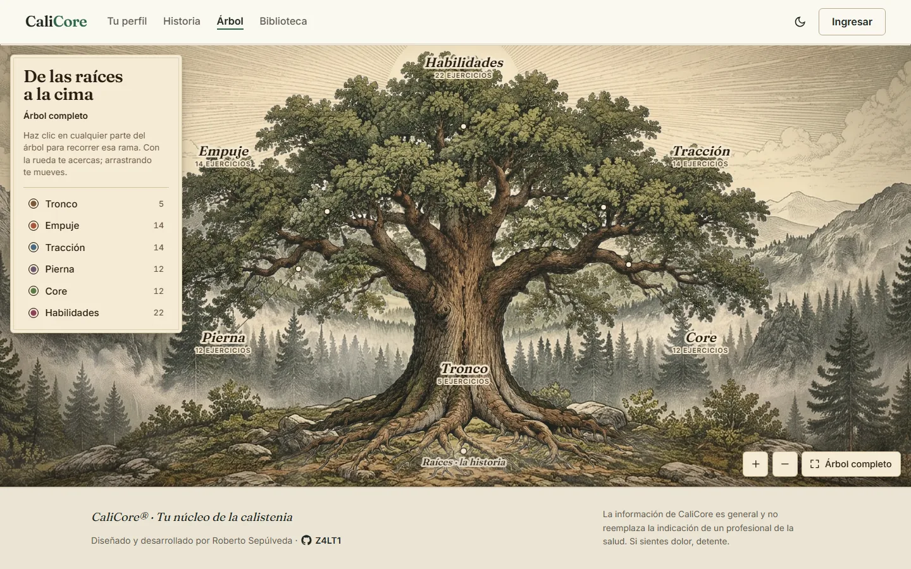 |
| **Una rama del árbol** | **Un ejercicio en el árbol** |
| 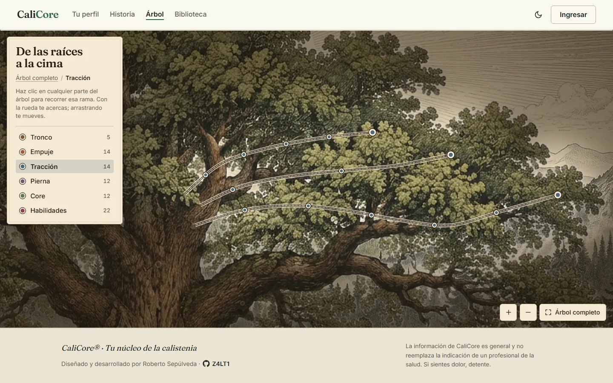 | 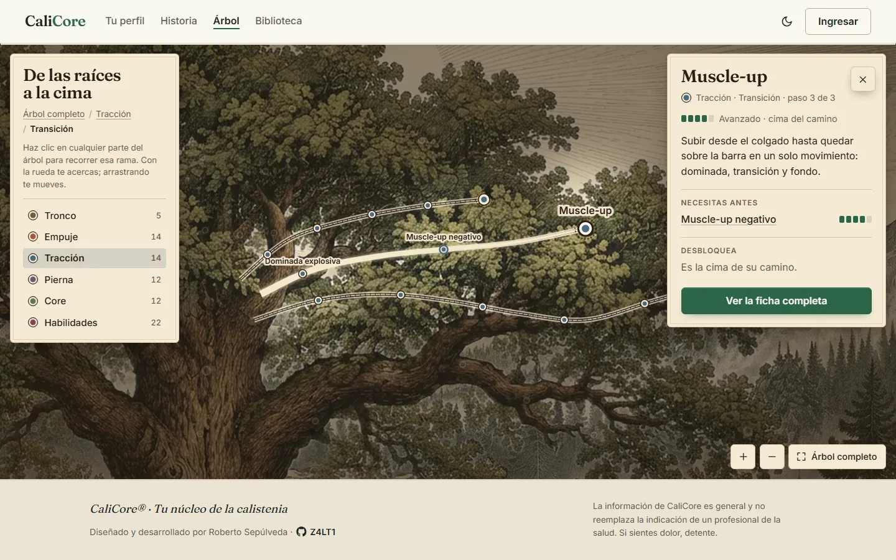 |
| **Biblioteca** | **Ficha de un ejercicio** |
| 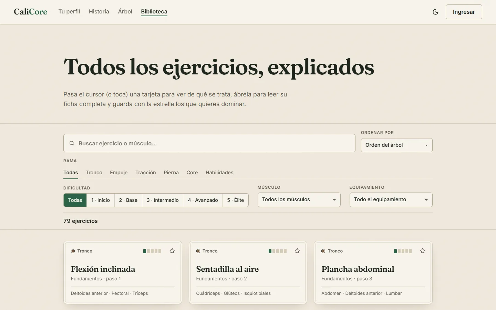 | 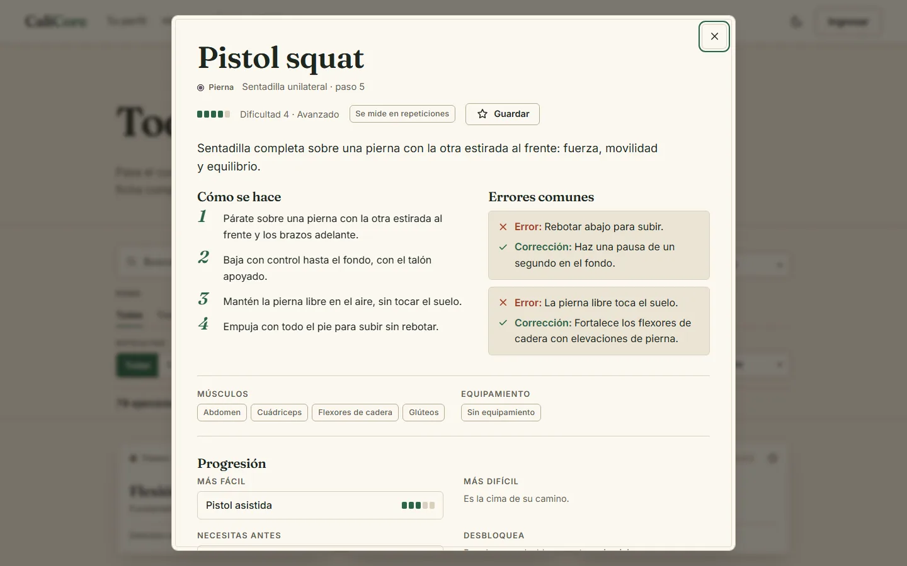 |
| **Historia** | **¿Qué quieres fortalecer?** |
| 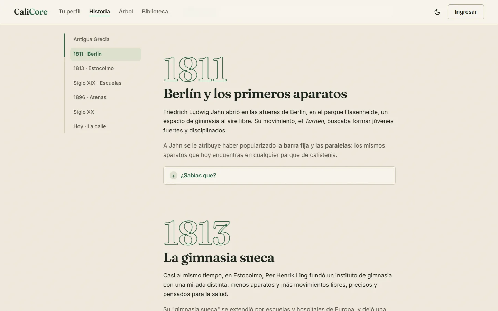 | 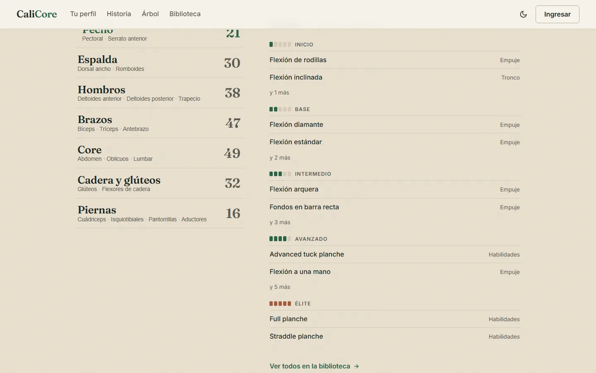 |
| **Tema oscuro** | **Perfil** |
| 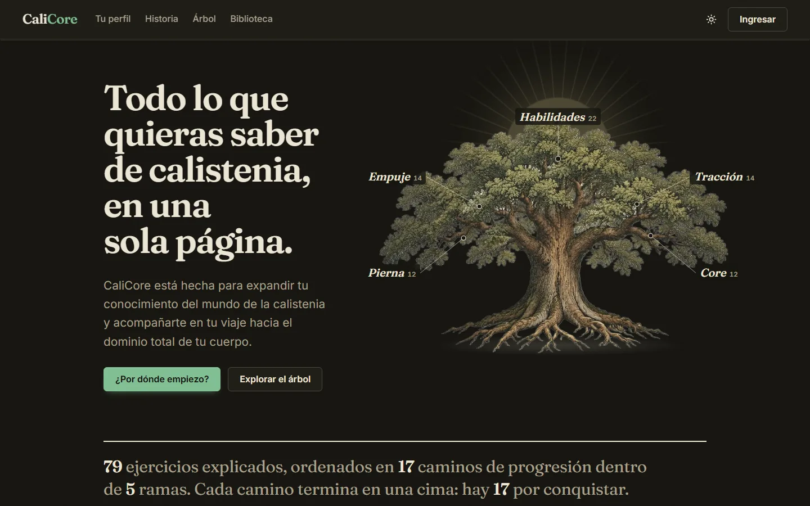 | 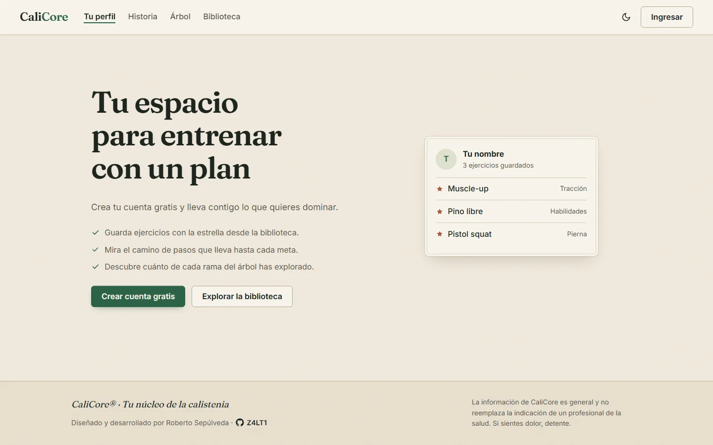 |

<div align="center">

| Árbol en celular | Inicio en celular |
|:---:|:---:|
| 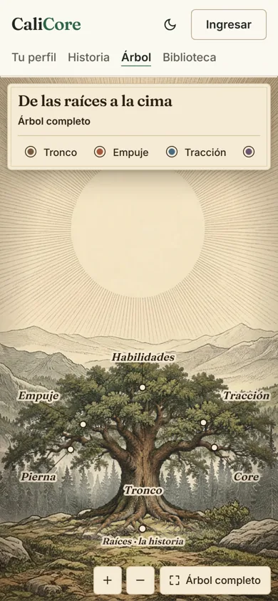 | 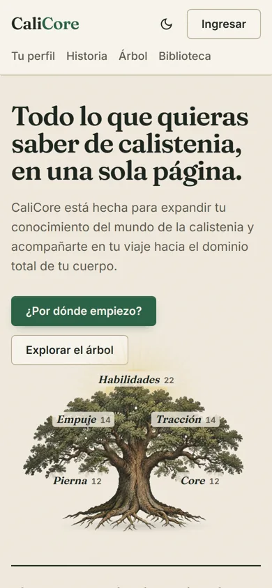 |

</div>

## 🧭 Recorrido por la página

El sitio tiene cinco secciones, cada una en su propia página: `Tu perfil · Historia · Árbol · Biblioteca`, además del inicio.

### Inicio

- **Lámina del roble:** la ilustración del árbol con sus cinco ramas señaladas. Al cargar, el sol sube, el árbol crece desde las raíces y aparecen los rótulos, que llevan directo a esa rama del árbol.
- **Cifras del catálogo** escritas como una frase, calculadas desde la base de datos real.
- **¿Por dónde empiezo?:** tres preguntas (cuántas flexiones, dominadas y sentadillas logras) y una recomendación del ejercicio ideal para empezar en cada rama.
- **Cada habilidad tiene un camino:** eliges un camino y se dibuja como una escalera, de la base a la cima.
- **Tarjetas de ejercicio** que se dan vuelta al pasar el cursor o al tocarlas.
- **¿Qué quieres fortalecer?:** un índice por zona del cuerpo (pecho, espalda, hombros, brazos, core, cadera y piernas) con los ejercicios que la trabajan, agrupados por dificultad.
- **Historia breve** e invitación al **perfil**.

### Árbol

La sección principal. El árbol ocupa toda la pantalla y se recorre como un mapa.

- **Escena en capas con profundidad:** el paisaje con el sol, la niebla del valle, el roble y una niebla baja delante de las raíces. Al moverte o acercarte, cada capa se desplaza a distinta velocidad (efecto *parallax*), lo que da sensación de profundidad.
- **Tres niveles de zoom**, para no mostrar 79 ejercicios a la vez:
  1. **Árbol completo:** solo las seis zonas. Al pasar el mouse por cualquier parte del árbol se ilumina la rama más cercana, y un clic la abre.
  2. **Una rama:** sus caminos se dibujan como trazos de grabado (doble línea con marcas) y aparecen los ejercicios como medallones. La cima de cada camino lleva un anillo.
  3. **Un ejercicio:** una franja de luz ("la savia") sube desde el tronco hasta el ejercicio, se muestran los nombres del camino y se abre su ficha breve con lo que necesitas antes y lo que desbloquea.
- **Navegación:** migas (`Árbol completo / Tracción / Transición`), lista de ramas, botones de zoom, tecla `Esc` para subir un nivel y enlaces directos (`arbol.html#muscle-up`, `arbol.html?rama=empuje`).
- **Raíces:** llevan a la historia de la calistenia.

### Biblioteca

- **Búsqueda sin tildes** por nombre, músculo o camino (buscar "flexion" encuentra "Flexión").
- **Filtros** por rama, dificultad, músculo y equipamiento, más "solo mis favoritos" con sesión iniciada. Se combinan entre sí y la lista se actualiza al instante.
- **Orden** del árbol, por dificultad o alfabético.
- **Ficha completa** en una ventana que se abre con la dirección (`biblioteca.html#pistol-squat`), así que se puede compartir y funciona con atrás y adelante: pasos, errores y su corrección, músculos, equipamiento, variante más fácil y más difícil, requisitos y lo que desbloquea.
- **Estrella de favorito** en cada tarjeta y en la ficha.

### Historia

- **El origen de la palabra:** un pequeño juego que une las raíces griegas *kállos* (belleza) y *sthénos* (fuerza).
- **Siete capítulos**, desde la Grecia clásica hasta el *street workout*, con datos curiosos desplegables.
- **Riel lateral** que sigue la lectura y marca la época actual.
- **Quiz** de cuatro preguntas para repasar lo leído.

### Tu perfil

- **Sin sesión:** una invitación con lo que se gana al crear una cuenta.
- **Con sesión:** tus cifras, cuánto de cada rama tienes guardado, tus metas (el camino de pasos hasta cada favorito difícil) y tus favoritos con filtro y orden.

## ✨ Funcionalidades

- **Registro, ingreso y cierre de sesión** con token, desde un diálogo accesible en cualquier página.
- **Catálogo de 79 ejercicios** con ficha completa, cargado desde un archivo JSON validado.
- **Árbol interactivo** con zoom, parallax, niveles y enlaces directos a cada rama y ejercicio.
- **Favoritos** sincronizados entre la biblioteca, el árbol y el perfil, con actualización inmediata en pantalla.
- **Búsqueda y filtros combinables** en el navegador, sin esperar al servidor.
- **Tema claro y oscuro:** sigue al sistema operativo y se puede cambiar con un botón.
- **Diseño adaptable** a escritorio, tablet y celular.
- **Accesible:** navegación con teclado, foco visible, textos alternativos y respeto por la opción "reducir movimiento" del sistema.

## ⚙️ ¿Cómo funciona?

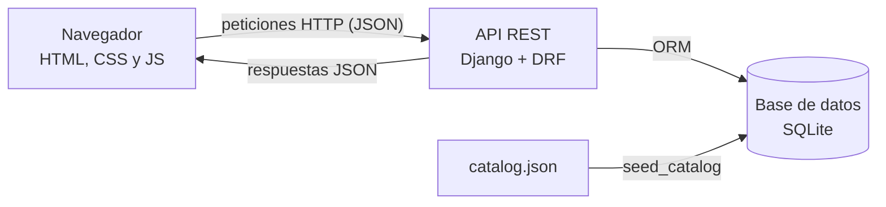

Son **dos aplicaciones separadas** que solo se hablan por HTTP. El frontend pide el árbol y la lista de ejercicios a la API, que los lee de la base de datos y los devuelve en formato JSON. El catálogo vive en un archivo (`catalog.json`) que un comando valida y carga en la base de datos. Cuando alguien inicia sesión, la API entrega un **token** (una llave aleatoria) que el navegador envía en cada petición privada, como guardar un favorito.

## 🛠️ Stack tecnológico

| Capa | Tecnología | Uso en el proyecto |
|---|---|---|
| Frontend | HTML, CSS y JavaScript con módulos ES | Las cinco páginas, sin framework, organizadas por funcionalidad |
| Herramienta de desarrollo | Vite | Servidor local y empaquetado final de las páginas |
| Animación | GSAP | Entrada de la escena, niebla, rayos de sol, parallax con el mouse |
| Cámara del árbol | d3-zoom | Zoom, arrastre y pellizco, y los vuelos de cámara entre ramas |
| Tipografías | Fraunces e Inter (alojadas en el sitio) | Títulos con serifa de estilo editorial y texto de lectura |
| Backend | Python 3.12, Django 5.2 LTS, Django REST Framework | API, autenticación por token, validación y permisos |
| Base de datos | SQLite (desarrollo) | Catálogo, usuarios y favoritos; preparado para PostgreSQL |
| Pruebas | Tests de Django, Playwright | 35 pruebas del backend; capturas y revisión visual del frontend |

## 🎨 Diseño visual

- **Una lámina de grabado antiguo.** El árbol es una ilustración en ese estilo, y todo el sitio la acompaña: fondo de papel cálido, texto color tinta, esquinas casi rectas y un doble filete en tarjetas y paneles.
- **Paleta:** un verde bosque que representa la voluntad (color de acción), arcilla para las cimas y los favoritos, y una tinta propia para cada rama. El tema oscuro es una "tinta nocturna" cálida que conversa con la ilustración.
- **Tipografía:** Fraunces para los títulos (con cursiva en los rótulos del árbol) e Inter para la lectura.
- **Movimiento con propósito:** cada animación explica algo, como el árbol que crece desde las raíces o la savia que sube por un camino. Con "reducir movimiento" activado, todo aparece quieto y en su lugar.
- **Íconos dibujados en SVG** y elementos del navegador (selección de texto, barras de desplazamiento, foco) con los colores del sitio.

## 🧩 Arquitectura y modularidad

### Frontend por capas

El JavaScript está dividido por responsabilidad, y cada funcionalidad vive en su propia carpeta:

| Carpeta | Contenido |
|---|---|
| `js/core/` | Lo genérico: configuración, peticiones a la API, sesión, creación segura de elementos y eventos |
| `js/services/` | Datos compartidos: catálogo (con caché), favoritos y cuenta |
| `js/ui/` | Piezas reutilizables: cabecera y pie, tema, tarjeta de ejercicio, medidor de dificultad |
| `js/features/` | Una carpeta por sección: `home`, `tree`, `library`, `history`, `profile`, `auth` |
| `js/pages/` | Un punto de entrada por página, que carga lo común y su funcionalidad |

Las funcionalidades **no se importan entre sí**: se comunican con eventos (`SESSION_CHANGED`, `FAVORITES_CHANGED`, `AUTH_REQUIRED`). Por ejemplo, al marcar una estrella en la biblioteca, el árbol y el perfil se enteran sin conocerse.

### Separación por tecnología

Cada sección tiene su HTML, su hoja de estilos y su carpeta de JavaScript con nombres paralelos:

| Sección | HTML | CSS | JS |
|---|---|---|---|
| Inicio | `index.html` | `css/sections/home.css` | `js/features/home/` |
| Árbol | `arbol.html` | `css/sections/tree.css` | `js/features/tree/` |
| Biblioteca | `biblioteca.html` | `css/sections/library.css` | `js/features/library/` |
| Historia | `historia.html` | `css/sections/history.css` | `js/features/history/` |
| Perfil | `perfil.html` | `css/sections/profile.css` | `js/features/profile/` |

Los estilos comparten una base común: `css/base/` (colores, tipografía y estructura), `css/components/` (botones, formularios, tarjetas, diálogo) y `css/sections/` (una hoja por sección, con su versión para celular).

### El árbol, en tres archivos

- `layout.js`: el mapa de la ilustración. Dónde está el sol, dónde se apoyan las raíces y por dónde pasa cada camino sobre las ramas dibujadas. Si cambia la imagen, solo se edita este archivo.
- `tree.view.js`: lo que se dibuja encima del árbol (zonas, tinta, medallones, savia y foco).
- `index.js`: la composición de las capas, la cámara, los niveles de zoom, las animaciones y la interacción.

### Backend por aplicaciones

| App | Responsabilidad |
|---|---|
| `accounts` | Registro, ingreso, cierre de sesión y datos de la cuenta |
| `exercises` | Ramas, caminos, ejercicios, pasos, errores, músculos y equipamiento; el comando `seed_catalog` |
| `favorites` | Los ejercicios guardados por cada usuario |

## 🗂️ Estructura del proyecto

```text
CaliCore/
├── backend/
│   ├── config/              configuración de Django (settings, urls)
│   ├── apps/
│   │   ├── accounts/
│   │   ├── exercises/
│   │   │   ├── data/catalog.json
│   │   │   └── management/commands/seed_catalog.py
│   │   └── favorites/
│   ├── manage.py
│   ├── requirements.txt
│   └── .env.example
├── frontend/
│   ├── index.html, arbol.html, biblioteca.html, historia.html, perfil.html
│   ├── css/
│   │   ├── base/
│   │   ├── components/
│   │   └── sections/
│   ├── js/
│   │   ├── core/
│   │   ├── services/
│   │   ├── ui/
│   │   ├── features/
│   │   └── pages/
│   ├── assets/tree/         capas de la ilustración (paisaje, árbol, niebla)
│   ├── scripts/capturas.mjs
│   ├── package.json
│   └── vite.config.js
└── docs/capturas/           capturas usadas en este README
```

## 🗄️ Base de datos

El catálogo se modela como un árbol: cada **rama** tiene **caminos**, y cada camino tiene **ejercicios** ordenados por paso. Un ejercicio puede **requerir** a otros (son las conexiones del árbol) y tiene una variante más fácil y otra más difícil. Los favoritos relacionan a cada usuario con los ejercicios que guardó, sin repetirse.

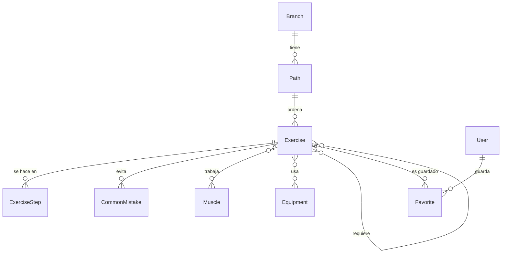

Las reglas importantes están en la base de datos misma: la dificultad solo puede ir del 1 al 5 y no puede haber dos ejercicios en el mismo paso de un camino.

## 🔌 API

| Método | Ruta | Acceso | Qué hace |
|---|---|---|---|
| `GET` | `/api/tree/` | Público | El árbol completo: ramas, caminos y ejercicios con sus requisitos |
| `GET` | `/api/exercises/` | Público | Lista de ejercicios, con filtros por rama, camino, dificultad, músculo, equipamiento y búsqueda |
| `GET` | `/api/exercises/<slug>/` | Público | Ficha completa de un ejercicio |
| `POST` | `/api/auth/register/` | Público | Crea una cuenta y entrega un token |
| `POST` | `/api/auth/login/` | Público | Ingresa y entrega un token |
| `POST` | `/api/auth/logout/` | Con sesión | Invalida el token en el servidor |
| `GET` | `/api/auth/me/` | Con sesión | Usuario, correo y fecha de registro |
| `GET` | `/api/favorites/` | Con sesión | Los favoritos del usuario |
| `PUT` / `DELETE` | `/api/favorites/<slug>/` | Con sesión | Guarda o quita un favorito (repetir la acción no cambia el resultado) |

## 💻 Instalación local

### Requisitos

- [Python 3.12](https://www.python.org/) y [Node.js](https://nodejs.org/) 20.19 o superior (lo pide Vite 8).
- Git, o descargar el proyecto como `.zip` desde GitHub.

### Backend (una terminal, desde la carpeta `backend`)

```bash
py -m venv .venv
.venv\Scripts\activate
pip install -r requirements.txt
copy .env.example .env
python manage.py migrate
python manage.py seed_catalog
python manage.py runserver
```

La API queda en `http://127.0.0.1:8000/api/`. El servidor no arranca sin el archivo `.env`, a propósito: la clave secreta es obligatoria.

### Frontend (otra terminal, desde la carpeta `frontend`)

```bash
npm install
npm run dev
```

El sitio queda en `http://127.0.0.1:5500`. Las páginas deben abrirse con este servidor y no con doble clic, porque los módulos de JavaScript no cargan desde un archivo local.

## 🧪 Pruebas

```bash
python manage.py test
```

Las 35 pruebas del backend cubren el registro y el ingreso, el catálogo y sus filtros, el árbol (incluido el número de consultas a la base de datos) y los favoritos, verificando que nadie pueda ver ni modificar los de otra persona.

Para el frontend, `npm run capturas -- despues` toma capturas de todas las páginas en escritorio y celular, en tema claro y oscuro, con Playwright.

## 🔐 Seguridad

- **Seguro por defecto:** toda la API exige sesión, salvo lo que se declara público a propósito (el catálogo, el registro y el ingreso).
- **Aislamiento por usuario:** los favoritos siempre se consultan filtrados por el usuario del token, así que nadie puede leer ni cambiar los de otra persona aunque modifique la dirección.
- **Contraseñas validadas y cifradas** con los validadores y el algoritmo de Django.
- **Límites de peticiones:** 300 por hora sin sesión, 3.000 con sesión y 20 por minuto en el ingreso y el registro, para frenar los ataques de fuerza bruta.
- **Sin inyección de código en la página:** el texto que viene del servidor se inserta siempre como texto plano (`textContent`), nunca como HTML.
- **Secretos fuera del repositorio:** la configuración sensible va en `.env`, ignorado por Git. `DEBUG` está apagado por defecto y se rechaza la clave de ejemplo en producción.
- **CORS con lista de orígenes:** la API solo acepta peticiones del frontend autorizado.

## 📚 Aprendizajes

- Diseñar una **API REST** con Django REST Framework, separando lo público de lo privado y optimizando las consultas.
- Modelar un **catálogo como un árbol** relacional, con requisitos entre ejercicios y reglas en la propia base de datos.
- Construir un **frontend modular sin framework**, con capas claras y funcionalidades que se comunican por eventos.
- Crear una **experiencia inmersiva** con capas, cámara, parallax y animación, cuidando el rendimiento y la accesibilidad.
- Mantener un **sistema visual coherente** en todo el sitio, en tema claro y oscuro.
- Aplicar **buenas prácticas de seguridad** desde el diseño: permisos, aislamiento por usuario, límites de peticiones y manejo de secretos.

## 🔭 Mejoras futuras

- [ ] **Despliegue público** con PostgreSQL y HTTPS.
- [ ] **Marcar ejercicios logrados** y ver el avance en el árbol.
- [ ] **Rutinas por nivel** y metas (fuerza, hipertrofia, flexibilidad).
- [ ] Tokens con vencimiento o cookies `HttpOnly`, y **recuperación de contraseña**.
- [ ] Documento de seguridad mapeado al **OWASP Top 10** y pruebas automáticas en **GitHub Actions**.
- [ ] Versión del frontend en **React**, consumiendo la misma API.

## 👤 Autor

**Roberto Sebastián Sepúlveda Quintana**: Analista Programador

[](https://github.com/Z4LT1)
[](https://www.linkedin.com/in/robertosepulvedaq)

## 📄 Créditos y licencia

- **Inspiración:** el enfoque de [Yellow Dude](https://yellowdude.co), que organiza la calistenia en pilares con niveles. CaliCore no copia su nombre, sus ilustraciones ni sus textos; si te interesa el tema, apoya su trabajo original.
- **Contenido:** los textos y las fichas de los ejercicios son originales de CaliCore. La información es general y no reemplaza la indicación de un profesional de la salud.
- **Ilustraciones del árbol y del paisaje:** [completar origen y licencia].
- Este repositorio se publica con fines de portafolio y no tiene licencia de uso comercial.
